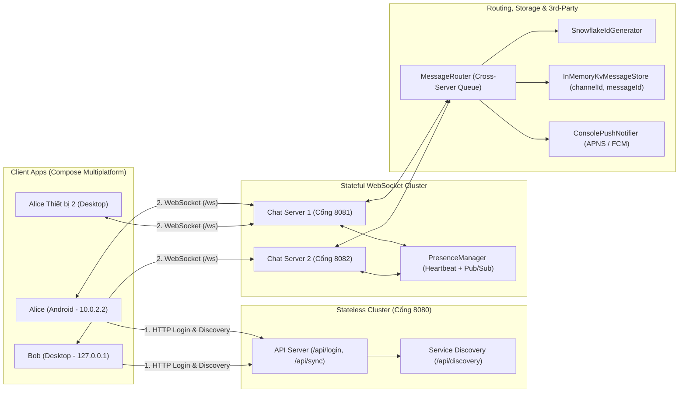
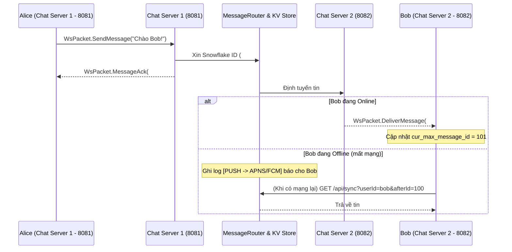

# System Design: Design a Chat System (Alex Xu – Chapter 12)

> **Báo cáo eLearning — Môn: Lập trình thiết bị di động**
> - **Giảng viên hướng dẫn:** Trương Quang Tuấn
> - **Sinh viên thực hiện:** Nguyễn Tùng Duy
> - **Slide thuyết trình (PowerPoint):** [`Design-A-Chat-System.pptx`](./Design-A-Chat-System.pptx)

---

## 1. Giới thiệu & Mục tiêu dự án

Dự án này hiện thực hóa kiến trúc **Hệ thống Chat thời gian thực (Chương 12 – *System Design Interview, Vol. 1* của Alex Xu)** bằng **Kotlin Multiplatform (Jetpack Compose cho Android + Desktop)** và **Ktor Backend**.

Thay vì chỉ tóm tắt lại lý thuyết trên giấy, dự án đi sâu vào **bản chất kỹ thuật (tại sao chọn kiến trúc đó, đánh đổi là gì, trên thiết bị di động thực tế hoạt động ra sao)** và chứng minh trực tiếp qua một cụm Backend phân tán thu nhỏ chạy thật trên 3 cổng mạng (`8080`, `8081`, `8082`).

---

## 2. Bản chất 5 Quyết định Thiết kế Cốt lõi

### 2.1. Tại sao chọn WebSocket nhưng vẫn giữ HTTP REST? (Và bài toán Pin trên Android)
* **Short Polling:** Mở/đóng kết nối và gửi HTTP Header lặp lại mỗi vài giây nhưng đa số nhận kết quả rỗng → lãng phí CPU server và đốt pin/4G trên điện thoại.
* **Long Polling:** Có 2 điểm nghẽn bản chất: (1) Người gửi và người nhận có thể kết nối vào 2 server khác nhau; (2) Server không nhận biết được ngay khi client mất mạng đột ngột.
* **WebSocket:** Duy trì đường ống TCP 2 chiều bền vững (Full-Duplex) với độ trễ gần bằng 0.
* **Đánh đổi (Trade-off):**
  1. Khi giữ WebSocket, **Chat Server trở thành Stateful** (khác với HTTP REST là Stateless). Vì vậy phải tách riêng **API Server (`8080` - Stateless)** khỏi **Chat Server (`8081`, `8082` - Stateful)** và cần **Service Discovery** điều phối.
  2. **Thực tế trên Android:** Khi người dùng tắt màn hình, cơ chế **Android Doze Mode** sẽ ngắt kết nối ngầm để bảo vệ pin. Do đó ứng dụng di động thực tế chỉ giữ WebSocket khi **App đang mở (Foreground)**, và chuyển sang **FCM / APNS** khi **App xuống nền (Background)**.

### 2.2. Tại sao lưu tin nhắn ở Key-Value Store (HBase/Cassandra) thay vì SQL?
* **Dữ liệu người dùng & danh sách bạn bè:** Ít thay đổi, cần tính toàn vẹn quan hệ → dùng **RDBMS (SQL)**.
* **Lịch sử tin nhắn:** Tỉ lệ ghi/đọc tin nhắn mới cực lớn, hiếm khi sửa đổi. Các hệ SQL truyền thống dùng **B-Tree** tốn nhiều thao tác ghi ngẫu nhiên trên đĩa (Random I/O) khi bảng phình lên hàng tỷ dòng. Trong khi đó, Cassandra/HBase dùng cấu trúc **LSM-Tree (Log-Structured Merge-Tree)** chuyên ghi nối tiếp tuần tự (*append-only*) nên chịu tải ghi cực tốt.
* Thiết kế khóa chính ghép **`(channel_id, message_id)`** giúp toàn bộ tin nhắn của cùng một cuộc hội thoại nằm liền kề nhau vật lý, giúp truy vấn `message_id > cur_max_message_id` chỉ tốn 1 lần quét tuần tự mà không cần `JOIN`.

### 2.3. Tại sao `message_id` phải dùng Snowflake thay vì Timestamp hay `AUTO_INCREMENT`?
* **Không dùng `System.currentTimeMillis()`:** Giữa nhiều máy chủ luôn có độ lệch đồng hồ vật lý vài mili-giây (**Clock Skew**) → tin nhắn trả lời ở Server 2 có thể mang timestamp nhỏ hơn câu hỏi ở Server 1, làm đảo lộn thứ tự hội thoại.
* **Không dùng `AUTO_INCREMENT` của SQL:** Không thể mở rộng ngang (sharding) trên nhiều node độc lập.
* **Giải pháp:** Dùng bộ sinh mã **Snowflake 64-bit** (`41 bit timestamp + 10 bit nodeId + 12 bit sequence`) đảm bảo vừa duy nhất toàn cục, vừa sắp xếp tăng dần theo thời gian.

### 2.4. Tại sao đặt con trỏ `cur_max_message_id` ở phía Thiết bị (Client)?
* Nếu bắt Server theo dõi trạng thái "đã nhận tới tin nhắn nào" cho từng thiết bị của 50 triệu người dùng, bộ nhớ trạng thái trên Server sẽ phình to.
* Khi mỗi thiết bị tự lưu biến `cur_max_message_id`, chỉ cần **1 API duy nhất (`GET /api/sync?userId=...&afterId=cur_max_message_id`)** để giải quyết đồng thời cả **đồng bộ đa thiết bị** lẫn **khôi phục tin nhắn bị lỡ sau khi mất mạng**.

### 2.5. Bản chất của Giới hạn Nhóm ≤ 100 người & Heartbeat Presence
* **Group Chat (≤ 100 người):** Dùng **Fan-out on Write** (nhân bản tin nhắn tới từng thành viên lúc gửi) để tối ưu tốc độ nhận và đơn giản hóa việc đồng bộ. Nếu nhóm lên tới hàng chục nghìn người, phải chuyển sang **Fan-out on Read** để tránh nghẽn hàng đợi.
* **Online Presence:** Khi điện thoại rớt mạng đột ngột (vào thang máy, hết pin), nó không thể gửi gói báo Logout. Cơ chế **Heartbeat** biến trạng thái Online thành một "hợp đồng gia hạn định kỳ" — quá thời gian timeout không thấy nhịp tim mới thì Server tự chuyển sang `OFFLINE` và phát **Pub/Sub** cho bạn bè.

---

## 3. Sơ đồ Kiến trúc & Luồng Hoạt động

### 3.1. Kiến trúc tổng thể (High-Level Architecture)



### 3.2. Luồng tin nhắn 1-1 xuyên Server & Đồng bộ khi mất mạng



---

## 4. Bảng Ánh xạ: Lý thuyết Sách Alex Xu ↔ Mã nguồn Thực tế

| Thành phần trong sách (Ch. 12) | File cài đặt trong Repo | Mô tả hoạt động thực tế trong code |
| :--- | :--- | :--- |
| **Data Models & Protocol** | [`Models.kt`](./shared/src/commonMain/kotlin/com/chatdemo/shared/Models.kt), [`Protocol.kt`](./shared/src/commonMain/kotlin/com/chatdemo/shared/Protocol.kt) | Định nghĩa `ChatMessage`, `UserPresence` và các gói tin `WsPacket` dùng chung giữa Server & App. |
| **Stateless API Server** | [`ApiServer.kt`](./server/src/main/kotlin/com/chatdemo/server/ApiServer.kt) | Chạy ở cổng `8080`: xử lý `/api/login`, `/api/discovery`, `/api/sync`. |
| **Service Discovery (Zookeeper)** | [`ServiceDiscovery.kt`](./server/src/main/kotlin/com/chatdemo/server/ServiceDiscovery.kt) | Theo dõi số kết nối đang mở trên `8081` & `8082`, chọn server ít tải nhất cho client mới. |
| **Stateful Chat Servers** | [`ChatWsServer.kt`](./server/src/main/kotlin/com/chatdemo/server/ChatWsServer.kt), [`Application.kt`](./server/src/main/kotlin/com/chatdemo/server/Application.kt) | Khởi chạy 2 WebSocket Server độc lập ở cổng `8081` (`chat-server-1`) và `8082` (`chat-server-2`). |
| **Snowflake ID Generator** | [`IdGenerator.kt`](./server/src/main/kotlin/com/chatdemo/server/IdGenerator.kt) | Sinh `messageId` 64-bit duy nhất và tăng dần theo thời gian. |
| **Key-Value Store (Cassandra/HBase)** | [`MessageStore.kt`](./server/src/main/kotlin/com/chatdemo/server/MessageStore.kt) | Lưu tin nhắn trong `ConcurrentSkipListMap` phân vùng theo `channelId`, truy vấn nhanh `tailMap(afterId)`. |
| **Message Sync Queue & Router** | [`MessageRouter.kt`](./server/src/main/kotlin/com/chatdemo/server/MessageRouter.kt) | Định tuyến tin nhắn xuyên `8081 ↔ 8082`, đồng bộ đa thiết bị và nhân bản tin nhắn nhóm (Fan-out). |
| **Presence Server (Heartbeat)** | [`PresenceManager.kt`](./server/src/main/kotlin/com/chatdemo/server/PresenceManager.kt) | Nhận `Heartbeat` mỗi 3s, quét timeout 10s (sách: 5s/30s) và phát Pub/Sub `PresenceUpdate` cho bạn bè. |
| **Push Notification (APNS/FCM)** | [`PushNotifier.kt`](./server/src/main/kotlin/com/chatdemo/server/PushNotifier.kt) | In log `[PUSH -> APNS/FCM]` khi người nhận không có kết nối WebSocket nào đang mở. |
| **Multiplatform Client (Android + Desktop)** | [`ChatNetworkClient.kt`](./composeApp/src/commonMain/kotlin/com/chatdemo/app/ChatNetworkClient.kt), [`ChatController.kt`](./composeApp/src/commonMain/kotlin/com/chatdemo/app/ChatController.kt) | Quản lý kết nối HTTP/WS, lưu `cur_max_message_id`, gửi Heartbeat ngầm và hỗ trợ nút *"Giả lập mất mạng"*. |
| **Kiểm thử tích hợp (Automated Tests)** | [`ServerIntegrationTest.kt`](./server/src/test/kotlin/com/chatdemo/server/ServerIntegrationTest.kt) | 6 bài test tự động kiểm tra: Snowflake ID, Discovery, Cross-server 1-1, Multi-device sync, Group fan-out, Presence timeout. |

---

## 5. Cấu trúc Thư mục

```text
Design-A-Chat-System/
├── README.md                    # Tài liệu tổng quan & hướng dẫn chạy
├── Design-A-Chat-System.pptx    # Bộ Slide thuyết trình PowerPoint (12 slides)
├── run-server.sh                # Script khởi chạy cụm Server độc lập (8080, 8081, 8082)
├── shared/                      # Module KMP dùng chung (Models, Protocol, DemoCatalog)
├── server/                      # Backend Ktor (API, Discovery, 2 Chat Servers, Router, KV, Presence)
├── composeApp/                  # Giao diện & logic Compose Multiplatform (commonMain + desktopMain)
└── androidApp/                  # Ứng dụng Android (MainActivity gọi vào composeApp)
```

---

## 6. Hướng dẫn Khởi chạy & Kịch bản Demo 5 Bước

### Bước 1: Chạy kiểm thử tự động (tùy chọn)
Mở [`ServerIntegrationTest.kt`](./server/src/test/kotlin/com/chatdemo/server/ServerIntegrationTest.kt) trong Android Studio và bấm **Run** (hoặc chạy `./gradlew :server:test`).

### Bước 2: Khởi động cụm Backend Server (Cổng 8080, 8081, 8082)
Trong Terminal tại thư mục gốc dự án:
```bash
./run-server.sh
```

### Bước 3: Mở ứng dụng Android & Desktop
* **Android:** Chọn cấu hình `androidApp` trên Android Studio → bấm **Run** trên máy ảo Android (mặc định dùng Host `10.0.2.2`).
* **Desktop:** Chọn cấu hình `composeApp [jvm]` (hoặc chạy [`Main.kt`](./composeApp/src/desktopMain/kotlin/com/chatdemo/desktop/Main.kt)) → bấm nút **`+ Cửa sổ`** ở góc trên ứng dụng để mở thêm cửa sổ thứ 2, thứ 3.

### Bước 4: Thực hiện 5 Kịch bản Demo (khớp với Slide 6 → Slide 10)
1. **Service Discovery:** Đăng nhập **Alice** trên Android (được phân vào `chat-server-1:8081`) và **Bob** trên Desktop 1 (được tự động phân sang `chat-server-2:8082`).
2. **Chat 1-1 xuyên Server:** Alice nhắn cho Bob → quan sát nhãn `#id • chat-server-1 -> chat-server-2` dưới mỗi tin nhắn.
3. **Đồng bộ đa thiết bị (`cur_max_message_id`):** Bấm **`+ Cửa sổ`** trên Desktop mở cửa sổ 2 → đăng nhập **Alice** → toàn bộ lịch sử tự đồng bộ về.
4. **Mất mạng đột ngột (Heartbeat Timeout) & Push:** Trên Bob bấm **`Giả lập mất mạng`** → sau 10s Alice thấy Bob chuyển `Offline`. Alice nhắn tiếp 1 tin → Terminal in `[PUSH -> APNS/FCM]`. Bấm **`Kết nối lại`** trên Bob → tự kéo về tin nhắn bị lỡ.
5. **Chat Nhóm (Group Fan-out):** Vào **`Nhóm KMP & System Design`** nhắn thử để kiểm chứng fan-out tới các thành viên.
